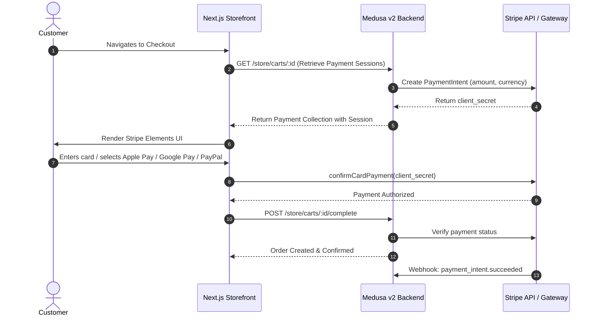

# 💳 International Payment Gateways Guide (Stripe & PayPal)

This document provides a comprehensive guide for configuring and operating international payment gateways in **Loomix Commerce** using **Medusa v2** and the **Next.js Storefront**.

---

## 📑 Table of Contents

1. [Architecture Overview](#1-architecture-overview)
2. [Supported Payment Providers](#2-supported-payment-providers)
3. [Stripe Configuration & Activation](#3-stripe-configuration--activation)
   - [Step 1: Obtain Stripe API Keys](#step-1-obtain-stripe-api-keys)
   - [Step 2: Configure Environment Variables](#step-2-configure-environment-variables)
   - [Step 3: Webhook Configuration](#step-3-webhook-configuration)
   - [Step 4: Enable Payment Methods (Apple Pay, Google Pay, iDeal, Bancontact)](#step-4-enable-payment-methods)
4. [PayPal Integration](#4-paypal-integration)
   - [Method A: Turnkey PayPal via Stripe APM (Recommended)](#method-a-turnkey-paypal-via-stripe-apm-recommended)
   - [Method B: Standalone PayPal Provider Architecture](#method-b-standalone-paypal-provider-architecture)
5. [Manual & Testing Provider (`pp_system_default`)](#5-manual--testing-provider-pp_system_default)
6. [Testing & Sandbox Verification](#6-testing--sandbox-verification)
   - [Stripe Test Cards](#stripe-test-cards)
   - [Local Webhook Forwarding via Stripe CLI](#local-webhook-forwarding-via-stripe-cli)
7. [Multi-Currency & Region Linking](#7-multi-currency--region-linking)
8. [Troubleshooting & FAQ](#8-troubleshooting--faq)

---

## 1. Architecture Overview

In Medusa v2, payment processing is decoupled into modular **Payment Collections** and **Payment Sessions**:



---

## 2. Supported Payment Providers

| Provider | Identifier in System | Supported Methods | Best For |
|---|---|---|---|
| **Stripe** | `pp_stripe_stripe` | Credit/Debit Cards, Apple Pay, Google Pay, iDeal, Bancontact | Global international sales |
| **PayPal via Stripe** | `pp_stripe_stripe` (Dynamic APM) | PayPal wallet balance & linked cards | Frictionless global checkout |
| **Manual / Offline** | `pp_system_default` | Cash on Delivery (COD), Wire Transfer, Sandbox | Demos, local dev, internal QA |

---

## 3. Stripe Configuration & Activation

Medusa v2 integrates with Stripe through the official `@medusajs/payment-stripe` module.

### Step 1: Obtain Stripe API Keys

1. Log in to your [Stripe Dashboard](https://dashboard.stripe.com/).
2. Navigate to **Developers > API keys**.
3. Copy the following keys:
   - **Publishable Key**: `pk_test_...` (for sandbox) or `pk_live_...` (for production).
   - **Secret Key**: `sk_test_...` (for sandbox) or `sk_live_...` (for production).

---

### Step 2: Configure Environment Variables

Update your `.env` files with your keys:

#### Root `.env` (Used by Docker Compose & Backend)
```env
# Stripe Backend Keys
STRIPE_KEY=sk_test_51Slu...
STRIPE_API_KEY=sk_test_51Slu...
STRIPE_WEBHOOK_SECRET=whsec_...

# Stripe Frontend Key
NEXT_PUBLIC_STRIPE_KEY=pk_test_51Slu...
```

#### `store/.env` (Used by Next.js Storefront)
```env
NEXT_PUBLIC_STRIPE_KEY=pk_test_51Slu...
```

#### `store-admin/.env` (Used by Medusa during local development)
```env
STRIPE_API_KEY=sk_test_51Slu...
STRIPE_WEBHOOK_SECRET=whsec_...
```

---

### Step 3: Webhook Configuration

Stripe webhooks ensure orders are reconciled even if the customer's browser is closed before the redirect completes.

1. Go to **Developers > Webhooks** in the Stripe Dashboard.
2. Click **Add destination** / **Add endpoint**.
3. Set the **Endpoint URL**:
   - Production: `https://api.yourdomain.com/hooks/payment/stripe`
   - Local testing: Use the [Stripe CLI](#local-webhook-forwarding-via-stripe-cli)
4. Select the events to listen for:
   - `payment_intent.succeeded`
   - `payment_intent.amount_capturable_updated`
   - `payment_intent.payment_failed`
5. Click **Add endpoint** and copy the **Signing secret** (`whsec_...`).
6. Set `STRIPE_WEBHOOK_SECRET=whsec_...` in `.env`.

---

### Step 4: Enable Payment Methods

Inside your Stripe Dashboard:
1. Navigate to **Settings > Payment methods**.
2. Enable:
   - **Cards** (Visa, Mastercard, American Express, Discover, Diners Club, JCB)
   - **Wallets** (Apple Pay, Google Pay)
   - **Local Payment Methods** (iDeal for Netherlands, Bancontact for Belgium, Sofort, etc.)

Apple Pay and Google Pay will automatically appear on supported devices in the checkout without additional code.

---

## 4. PayPal Integration

### Method A: Turnkey PayPal via Stripe APM (Recommended)

The most robust and zero-maintenance way to accept PayPal is through **Stripe Alternative Payment Methods (APM)**:

1. In your **Stripe Dashboard**, navigate to **Settings > Payment methods**.
2. Scroll to **Wallets & Alternative Payment Methods** and locate **PayPal**.
3. Click **Turn on** (or connect your existing PayPal Business account).
4. **Zero Code Changes Needed:** Stripe Elements in the Next.js Storefront (`@stripe/react-stripe-js`) automatically detects PayPal eligibility and displays the PayPal button directly in checkout.
5. All refunds, chargebacks, and payouts are unified in your Stripe Dashboard.

---

### Method B: Standalone PayPal Provider Architecture

If you prefer to connect directly to a dedicated PayPal Business Merchant account independent of Stripe:

1. Install a Medusa v2 PayPal community provider or register a custom provider under `store-admin/src/modules/paypal`:
   ```bash
   cd store-admin
   npm install @medusajs/payment-paypal # or custom provider
   ```
2. Register the provider in `store-admin/medusa-config.ts`:
   ```typescript
   {
     resolve: "@medusajs/payment",
     options: {
       providers: [
         // Stripe
         {
           resolve: "@medusajs/payment-stripe",
           id: "stripe",
           options: {
             apiKey: process.env.STRIPE_KEY,
             webhookSecret: process.env.STRIPE_WEBHOOK_SECRET,
           },
         },
         // Direct PayPal
         {
           resolve: "./src/modules/paypal",
           id: "paypal",
           options: {
             clientId: process.env.PAYPAL_CLIENT_ID,
             clientSecret: process.env.PAYPAL_CLIENT_SECRET,
             sandbox: process.env.PAYPAL_SANDBOX === "true",
           },
         },
       ],
     },
   }
   ```
3. In `store/src/lib/constants.tsx`, the identifier `pp_paypal_paypal` is already pre-configured with the official PayPal icon.

---

## 5. Manual & Testing Provider (`pp_system_default`)

For staging, demo showcases, or clients that accept manual bank transfers / Cash on Delivery:

- **Automatic Fallback:** If `STRIPE_KEY` is not provided in `.env`, Medusa defaults cleanly without crashing.
- **Pre-Seeded in Demo Data:** Both `US` and `AE` regions in `store-admin/src/scripts/seed.ts` have `pp_system_default` assigned by default.
- **Storefront Behavior:** The checkout button renders **"Place order"** immediately without prompting for card credentials.

---

## 6. Testing & Sandbox Verification

### Stripe Test Cards

Use the following card numbers in sandbox mode with any future expiration date (e.g., `12/28`) and any 3-digit CVC (`123`):

| Scenario | Card Number | Expected Result |
|---|---|---|
| **Success (Standard Visa)** | `4242 4242 4242 4242` | Payment succeeds immediately, order placed |
| **Success (3D Secure Required)** | `4000 0027 6000 3184` | Triggers 3D Secure modal challenge |
| **Card Declined** | `4000 0588 5000 5000` | Displays inline error: "Your card was declined" |
| **Insufficient Funds** | `4000 0000 0000 9995` | Displays inline error: "Insufficient funds" |
| **Expired Card** | `4000 0012 0000 0008` | Displays inline error: "Your card has expired" |

---

### Local Webhook Forwarding via Stripe CLI

To test webhooks on your local machine (`localhost:9000`):

1. Install the [Stripe CLI](https://docs.stripe.com/stripe-cli):
   ```bash
   # Windows (via Scoop or Chocolatey)
   scoop install stripe
   # Or macOS
   brew install stripe/stripe-cli/stripe
   ```
2. Authenticate:
   ```bash
   stripe login
   ```
3. Start listening and forwarding events to your Medusa backend:
   ```bash
   stripe listen --forward-to localhost:9000/hooks/payment/stripe
   ```
4. Copy the webhook secret printed in the terminal (`whsec_...`) and paste it into `.env`:
   ```env
   STRIPE_WEBHOOK_SECRET=whsec_...
   ```
5. Trigger a test event:
   ```bash
   stripe trigger payment_intent.succeeded
   ```

---

## 7. Multi-Currency & Region Linking

To accept payments in a given currency, the payment provider must be linked to the **Tax Region** and **Sales Channel Region** in Medusa:

1. Log into **Medusa Admin Dashboard** (`http://localhost:9000/app` or `https://api.yourdomain.com/app`).
2. Go to **Settings > Regions**.
3. Select your target region (e.g., `United States` or `European Union`).
4. Under **Payment Providers**, ensure **Stripe** (`pp_stripe_stripe`) is checked.
5. Save changes.

---

## 8. Troubleshooting & FAQ

### Q: Checkout says "Select payment method" and button is disabled?
> **Solution:** Ensure a payment session is active on the cart. In Medusa Admin > Settings > Regions, check that `pp_stripe_stripe` or `pp_system_default` is assigned to the customer's region.

### Q: Medusa crashes on startup with `Required option apiKey is missing in Stripe plugin`?
> **Solution:** In `medusa-config.ts`, Stripe is conditionally loaded only when `STRIPE_KEY` or `STRIPE_API_KEY` is present. If you do not wish to use Stripe, leave both variables empty and Medusa will boot using the manual provider.

### Q: Can customers pay in multiple currencies (USD, EUR, GBP)?
> **Solution:** Yes. Stripe handles multi-currency conversions automatically. Create the respective regions and currencies in Medusa Admin, and Stripe will charge the customer in their native currency.
